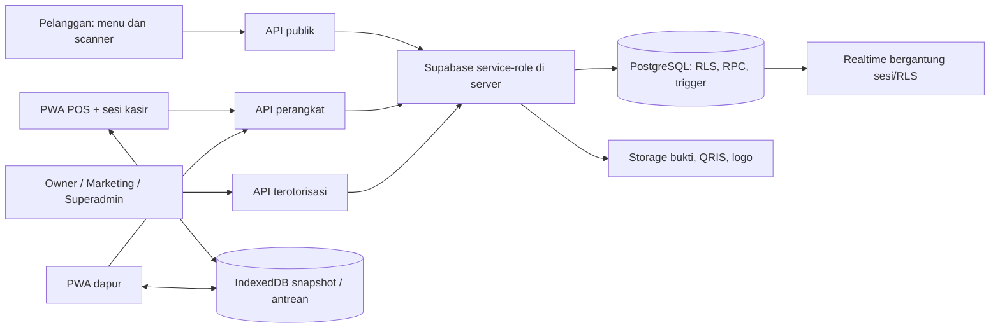

# Laporan audit menyeluruh OKESIH.COM

Tanggal pemeriksaan: 20 Oktober 2026 (WITA). Baseline kode: `e5d743dbb52ee5ba746bee2d4f0ac5900ad02deb`, branch `main`. Laporan ini menilai implementasi yang tersedia, bukan hanya rancangan pada README. Tidak ada perbaikan perilaku aplikasi atau perubahan data produksi dalam pekerjaan audit ini.

## 1. Kesimpulan eksekutif

Aplikasi telah memiliki fondasi yang berguna: pembagian portal, autentikasi server, pairing perangkat, validasi input, transaksi SQL untuk sebagian proses, ledger komisi, agregasi laporan, dan cache offline. Build produksi berhasil. Namun, **belum layak dinyatakan aman dan konsisten untuk perluasan operasional tanpa menyelesaikan temuan prioritas tinggi**.

Masalah utama bukan sekadar ukuran komponen. Batas kepercayaan pembayaran, izin database, konsistensi transaksi ketika koneksi putus, serta kesesuaian perubahan skema dengan API masih memiliki celah. Contoh paling penting: gambar yang teks nominalnya cocok dapat mengubah tagihan menjadi PAID; password awal owner dapat diturunkan dari slug; cron menerima User-Agent sebagai autentikasi; dashboard owner masih mengasumsikan satu tagihan per hari setelah skema berubah menjadi per-shift.

Penilaian per bidang:

| Bidang | Hasil audit |
| --- | --- |
| Struktur dan modularitas | Cukup terorganisasi; masih ada komponen besar, duplikasi helper, dan kontrak yang tidak seragam |
| Keamanan aplikasi/database | Perlu perbaikan segera pada pembayaran, kredensial awal, RLS lama, cron, dan privasi |
| Logika transaksi/keuangan | Perlindungan SQL ada, tetapi retry, penutupan shift, dan pelaporan belum konsisten menyeluruh |
| Offline/PWA | Mendukung snapshot dan antrean perubahan status; belum merupakan POS penuh yang bisa membuat pesanan offline |
| Performa | Beberapa optimasi nyata sudah ada; polling, payload, OCR, dan precache tetap memerlukan perbaikan |
| Pengujian/operasional | Build dan tes terpilih lulus; lint gagal; belum ada bukti pengujian integrasi lengkap maupun pemulihan produksi |

Prioritas pada laporan ini merupakan rekomendasi teknis: P0 = segera karena dampak langsung pada integritas pembayaran; P1 = tinggi, diselesaikan sebelum ekspansi; P2 = penting untuk keandalan dan efisiensi. Ini bukan skor CVSS atau klaim bahwa eksploitasi telah terjadi.

## 2. Cakupan, metode, dan batas pembuktian

Inventaris `src`: **28 halaman, 45 API route, 92 file TypeScript, 92 TSX, 12 CSS**, total sekitar **39.986 baris**. Database didefinisikan melalui **25 migrasi**, dengan 22 deklarasi tabel aplikasi. Pemeriksaan mencakup App Router, proxy, helper auth, API publik/perangkat/owner/marketing/superadmin, model data, migrasi lanjutan, trigger komisi, service worker, IndexedDB, aset, dependency, script, dan dokumentasi operasional.

Metode: pemetaan seluruh struktur dan endpoint; pembacaan mendalam jalur sensitif; penelusuran perubahan definisi SQL dari migrasi awal sampai akhir; build, lint, tes; inspeksi artefak; dua probe perilaku lokal dengan dependency palsu; serta GET/HEAD publik ke deployment. Panduan Route Handlers dari `node_modules/next/dist/docs/` dibaca untuk mengikuti Next.js yang benar-benar terpasang.

Tingkat bukti dibedakan:

- **Kode**: jalur atau kontrak bermasalah terlihat langsung dalam implementasi. Skenario kegagalan produksi belum tentu sudah terjadi.
- **Probe lokal**: perilaku dikonfirmasi memakai kode asli dan dependency mock; tidak menyentuh data produksi.
- **Produksi terbatas**: hanya respons HTTP publik, health, dan status deployment GitHub.
- **Perlu verifikasi database**: hasil migrasi repository tidak membuktikan ACL, RLS, indeks, dan konfigurasi yang benar-benar terpasang di Supabase aktif.

Tidak dilakukan: transaksi nyata, unggahan bukti, penghapusan data, percobaan password, pemanggilan RPC mutasi produksi, pembacaan data pribadi produksi, EXPLAIN ANALYZE produksi, uji beban, Lighthouse/browser end-to-end, audit seluruh histori Git, atau restore backup. Konfigurasi WAF, dashboard Supabase/Vercel, backup/PITR, dan metrik pengguna belum diinspeksi. Karena itu laporan ini tidak menyatakan kepatuhan, jaminan bebas celah, atau angka kapasitas produksi.

## 3. Struktur sistem dan alur data



`src/lib/app-origins.ts` dan `src/proxy.ts` memisahkan origin publik, owner, superadmin, marketing, POS, dan KDS. Ini membantu pemisahan cookie dan routing, tetapi bukan pengganti otorisasi endpoint. Domain preview/localhost sengaja tidak dibatasi seperti domain produksi.

`requireOwner` memeriksa pengguna dan membership OWNER aktif. `requireCashier` memeriksa bearer token serta membership KASIR aktif untuk tenant perangkat. `requireDevice` memeriksa hash token cookie, tipe, status, dan expiry. API memakai service-role sehingga filter tenant dan guard server menjadi batas keamanan utama. Jalur akses langsung dari browser ke Supabase tetap perlu ditutup dengan RLS yang sesuai.

Handoff login sudah menggunakan kode acak, hash, expiry 60 detik, payload AES-GCM, target surface, dan consume bersyarat. Token dikirim melalui fragment lalu ditukar lewat POST. Ini merupakan keputusan desain yang baik.

Kelompok data:

| Kelompok | Tabel utama | Catatan |
| --- | --- | --- |
| Tenant dan identitas | warkops, warkop_members, owner_onboarding | Membership berbeda dengan role pada auth metadata; keduanya harus tetap konsisten |
| Katalog dan layanan | menus, warkop_tables, waiters, waiter_shifts | Model waiter lama masih memiliki izin/fungsi yang perlu ditinjau |
| Operasi penjualan | shifts, transactions, transaction_items | Snapshot harga disimpan di item; satu shift OPEN per tenant |
| Perangkat dan audit | device_pairing_requests, device_installations, operation_idempotency, audit_logs | Mendukung pencabutan dan retry, tetapi tidak semua perubahan atomik |
| Billing dan afiliasi | saas_billings, marketing_partners, marketing_commission_mutations, marketing_commission_withdrawals, tenant_applications | Migrasi 25 mengubah tagihan menjadi per-shift dan ledger menjadi immutable |
| Infrastruktur | platform_settings, whatsapp_outbox, auth_handoff_codes | Outbox masih direferensikan alur lama; worker tidak tersedia dalam script package |

Kekuatan database yang perlu dipertahankan: atomic creation order dan item pada RPC; advisory lock penomoran; unique idempotency; partial unique index shift aktif; lock pada withdrawal; guard settled billing; unique komisi per billing/kind; agregasi reporting server; indeks item transaksi dan histori tenant. Migrasi 11 sudah mencabut akses transaksi anonim pada skema awal, dan migrasi 25 sudah menutup kebijakan marketing lama. Keduanya **tidak** dilaporkan sebagai celah anonim yang masih berlaku.

## 4. Temuan keamanan dan privasi

### A01 — P0: OCR dijadikan bukti pembayaran final

**Bukti kode:** `src/lib/billing-proof-ocr.ts`, fungsi `verifyBillingProof`; `src/app/api/owner/billing/route.ts`, POST; trigger komisi pada migrasi 25. Keputusan `verified` hanya memerlukan confidence ≥30, kata konteks pembayaran, dan nominal yang cocok. Endpoint kemudian menulis `status_bayar: "PAID"`, yang dapat memicu komisi.

Gambar teks yang direkayasa dapat memenuhi aturan tanpa membuktikan dana diterima. Tidak ada konfirmasi transaksi dari bank/payment provider, identitas penerima, nomor transaksi unik, atau pemeriksaan pemakaian ulang bukti. Belum dilakukan percobaan pemalsuan gambar pada produksi; masalahnya adalah batas kepercayaan yang terlihat jelas dalam kode.

**Perbaikan:** OCR hanya membantu ekstraksi dan mengubah status ke PENDING_REVIEW. PAID berasal dari rekonsiliasi pihak pembayaran yang terautentikasi atau persetujuan admin yang diaudit. Simpan referensi settlement dan cegah penggunaan ulang. Uji bahwa gambar dengan nominal cocok saja tidak melunasi tagihan atau menciptakan komisi.

### A02 — P1: Password awal owner dapat ditebak dari identitas publik

**Bukti kode:** `src/app/api/superadmin/tenant-applications/route.ts:58–62` membentuk suffix dari enam digit akhir `Date.now()`, slug berakhiran suffix yang sama, username `owner_${suffix}`, dan password dengan pola tetap berdasarkan suffix. `requireOwner` tidak mewajibkan onboarding selesai untuk seluruh API owner.

Selama password awal belum diganti, slug tenant mengungkap bahan pembentuk username/password. Tampilan onboarding tidak cukup sebagai pembatas server. Risiko terbatas pada akun yang dibuat melalui alur ini dan belum mengganti password; akun yang dibuat manual tidak otomatis mengikuti pola tersebut.

**Perbaikan:** kredensial awal acak kriptografis atau undangan sekali pakai dengan expiry. Batasi sesi onboarding hanya untuk mengganti kredensial. Tinjau akun yang belum menyelesaikan onboarding dan lakukan rotasi terarah.

### A03 — P1: Cron mempercayai User-Agent yang bisa dipalsukan

**Bukti kode/probe lokal:** `src/app/api/cron/cleanup-billing-proofs/route.ts:8–10`. Otorisasi menerima secret **atau** `User-Agent: vercel-cron/1.0`. Probe lokal menunjukkan header tersebut mendapat HTTP 200 tanpa bearer secret, bahkan ketika CRON_SECRET terisi.

Pemanggil tanpa izin dapat memicu pekerjaan storage/database dan pembersihan bukti yang memenuhi aturan retensi 90 hari. Batas retensi tetap berlaku; ini bukan kemampuan menghapus sembarang file.

**Perbaikan:** wajibkan secret server dan tolak jika konfigurasi secret tidak tersedia. User-Agent hanya metadata. Tambahkan uji negatif untuk User-Agent palsu. Probe tidak dijalankan pada endpoint produksi.

### A04 — P1: RPC lama close_waiter_shift belum dibatasi

**Bukti migrasi:** `02_functions_triggers.sql:9–58`: SECURITY DEFINER, menerima ID shift, tanpa pemeriksaan pengguna/tenant, status akhir, atau lock. Tidak ditemukan REVOKE untuk fungsi ini pada migrasi berikutnya. Berbeda dengan close_shift yang sudah dibatasi migrasi 17.

PostgreSQL memberikan EXECUTE kepada PUBLIC untuk fungsi baru secara default; SECURITY DEFINER memakai hak pemilik fungsi. Karena itu ada risiko pemanggilan langsung lintas tenant bila ACL bawaan dan exposure schema tersebut berlaku. **ACL database aktif belum dibaca**, sehingga keterjangkauan di produksi masih perlu diverifikasi. [Referensi PostgreSQL](https://www.postgresql.org/docs/current/sql-createfunction.html).

**Perbaikan:** cabut izin PUBLIC/anon/authenticated sesuai kebutuhan; batasi ke service-role atau lakukan validasi identitas/tenant di fungsi; tetapkan search_path aman, lock, dan perilaku retry. Uji matriks role dengan fixture dua tenant.

### A05 — P1: RLS staf masih terlalu luas dan mengabaikan status aktif

**Bukti migrasi:** `01_schema_and_rls.sql:175–178,185–187,206–208,224–226`. `current_user_warkop_id()` hanya mencari user_id; tidak memeriksa is_active atau role. Policy FOR ALL pada menus, transactions, waiter_shifts masih bergantung helper ini dan tidak diganti migrasi lanjutan.

Dengan grant tabel yang sesuai, staf dapat mengakses tabel langsung melalui JWT browser dan melewati state machine API, validasi pembayaran, pairing, serta audit. Efeknya terutama pada tenant sendiri, bukan klaim otomatis akses lintas tenant. Proses ban auth saat menonaktifkan staf tidak menggantikan pemeriksaan membership pada RLS untuk token yang masih berlaku.

**Perbaikan:** policy per operasi/peran yang eksplisit, membership aktif, dan tutup mutasi langsung transaksi bila seluruh perubahan harus melalui RPC tervalidasi. Verifikasi ACL aktual dan uji peran KASIR/DAPUR/OWNER yang dinonaktifkan.

### A06 — P1: Policy profil publik mencakup kolom privat yang ditambahkan kemudian

**Bukti migrasi:** policy SELECT warkops dengan `USING (is_active = true)` pada migrasi 01; owner_name/owner_phone ditambahkan migrasi 09, alamat migrasi 21, kolom history_pin_hash/salt migrasi 19. RLS membatasi baris, bukan otomatis membatasi kolom baru. Tidak ditemukan pembatasan kolom pada tabel ini di migrasi.

Endpoint menu sudah memilih field publik secara sempit, tetapi itu tidak menutup jalur REST tabel langsung bila anon memiliki SELECT. Risiko kebocoran kontak owner dan konfigurasi internal perlu diverifikasi terhadap grant produksi. Kolom PIN migrasi 19 tampak tidak dipakai oleh implementasi PIN sekarang; jangan menganggap berisi hash tanpa memeriksa data.

**Perbaikan:** pisahkan profil publik melalui view/RPC dengan daftar kolom eksplisit atau hilangkan grant tabel anonim. Uji bahwa anon tidak bisa mengambil field owner pribadi.

### A07 — P1: PIN audit tidak melindungi seluruh jalur histori

**Bukti kode:** bootstrap perangkat menerima `history` yang default-nya aktif dan mengirim 200 transaksi terakhir beserta item/bukti, hanya dengan requireDevice; tidak memakai requireDeviceHistory. Sebaliknya endpoint histori berpagination memakai header X-Audit-Pin. Lihat `src/app/api/device/bootstrap/route.ts:6–7,48–50,107–112` dan `src/lib/device-history.ts`.

Pemegang perangkat POS dapat memperoleh histori terbaru tanpa memasukkan PIN. Selain itu PIN tersimpan plaintext dalam `warkop_members.display_name` dengan prefiks AUDIT_PIN, bukan kolom hash khusus; `audit-pin` membandingkannya langsung dan tidak memiliki pembatasan percobaan di aplikasi.

**Perbaikan:** satu guard histori untuk semua endpoint dan snapshot; PIN di penyimpanan hash tersendiri, pembatasan percobaan dan masa berlaku otorisasi audit. PIN layar lokal PBKDF2 pada device-pin berbeda dan tidak menyelesaikan masalah PIN owner ini.

### A08 — P1: Forgot-password membocorkan data akun kepada pemanggil anonim

**Bukti kode:** `src/app/api/auth/forgot-password/route.ts`, POST. Berdasarkan username/nomor, endpoint membedakan akun tidak ditemukan dan mengembalikan nama, username, nomor WhatsApp, nama bisnis, serta tautan berisi data tersebut. Tidak ada verifikasi kepemilikan akun sebelum respons.

Ini memungkinkan enumerasi dan pengumpulan data kontak. Endpoint juga menulis audit/outbox atas identitas target meskipun pemohon belum terverifikasi. Tidak ada percobaan terhadap akun nyata dalam audit.

**Perbaikan:** respons generik yang seragam, tidak mengembalikan detail akun, pembatasan laju, dan verifikasi kepemilikan melalui kanal yang telah terdaftar. Bedakan aktor anonim dari pemilik akun pada audit.

## 5. Temuan logika, konsistensi, dan database

### A09 — P1: Idempotency belum menyeluruh pada pembuatan dan perubahan pesanan

**Bukti kode:** POST public orders membuat customerToken baru pada setiap request; RPC create_customer_order mengembalikan order lama ketika key sudah ada tanpa mengganti hash token. Akibatnya retry dengan key sama mengembalikan token baru yang tidak dapat membaca order tersebut. RPC juga memeriksa existing sebelum advisory lock, sehingga dua request bersamaan dapat sama-sama lolos pemeriksaan awal; unique index mencegah duplikasi, tetapi request kedua dapat gagal dengan unique violation.

Frontend menu dan `createCashierOrder` menghasilkan key baru per submit, sehingga retry pengguna setelah respons hilang dapat membuat order baru. Unggah bukti dilakukan sebelum deduplikasi RPC, berpotensi meninggalkan file yang tidak dirujuk. Perubahan status di `device/orders` melakukan update, pencatatan idempotency, dan audit dalam operasi terpisah; kegagalan sesudah update dapat membuat retry berakhir 409 meskipun perubahan pertama berhasil.

**Perbaikan:** pertahankan key per intent sampai hasil pasti, ikat key ke hash payload, dan kembalikan hasil yang sama pada retry. Gabungkan state transition, audit, dan receipt idempotency dalam transaksi SQL. Pastikan token tracking dapat dipulihkan dengan aman tanpa mengungkap token order lain; jangan sekadar mengganti token setiap retry. Uji respons hilang, request serentak, serta retry setelah status berubah.

### A10 — P1: Dashboard owner masih mengasumsikan satu billing per hari

**Bukti kode/migrasi:** migrasi 25 melepas keunikan tenant/tanggal dan memakai billing per-shift. `src/app/api/owner/dashboard/route.ts:15–18` tetap mengambil billing tenant/tanggal dengan `.maybeSingle()` dan melempar error bila lebih dari satu baris.

Dua shift yang ditutup pada hari yang sama dapat membuat dashboard owner gagal, meskipun kedua tagihan valid. `owner/billing` juga mencari tagihan belum lunas hanya dari 15 billing terbaru, sehingga tunggakan yang lebih tua bisa tidak dipilih sebagai tagihan aktif.

**Perbaikan:** agregasi tagihan per hari atau kembalikan koleksi per-shift. Query tagihan belum lunas terpisah dari histori terakhir. Uji tenant dengan dua shift sehari dan tunggakan di luar 15 entri terbaru.

### A11 — P1: Penghapusan tenant dapat meninggalkan kondisi setengah terhapus

**Bukti kode/migrasi:** DELETE `src/app/api/superadmin/tenants/route.ts:368–425` melakukan banyak delete terpisah, mayoritas tanpa memeriksa `error`. Migrasi 25 menolak penghapusan billing settled dan ledger komisi.

Untuk tenant dengan histori settled, operasi akhir dapat gagal setelah transaksi, menu, perangkat, membership, atau audit tertentu sudah terhapus. Terdapat referensi tabel `affiliate_commissions` dan `warkop_security_pins` yang tidak didefinisikan dalam migrasi repository. Pembersihan storage tidak rekursif terhadap folder tanggal bukti pelanggan dan tidak mencakup prefix saas-billings secara menyeluruh.

**Perbaikan:** gunakan arsip/nonaktif untuk tenant berhistori keuangan. Jika penghapusan memang diperbolehkan, preflight seluruh constraint dan jalankan perubahan database atomik; cleanup Auth/Storage harus terjadwal, bisa diulang, dan diperiksa hasilnya. Uji hanya pada database disposable.

### A12 — P1: Antrean offline bisa dibuang tanpa pemulihan dan batas waktunya tidak kokoh

**Bukti kode:** `src/lib/use-device-app.ts:65–86` menghapus operasi setelah error 4xx kecuali 401, termasuk konflik 409 dan 429. Snapshot diberi izin kembali pada fallback tanpa memvalidasi umur/expiry di jalur refresh. `transitionOrder` menggunakan `Date.now()` sebagai awal offline ketika cachedAt null; handleOffline menulis ulang waktu cache dari snapshot tanpa verifikasi server.

Pada tab yang sebelumnya online, cachedAt bisa tetap null sampai reload, sehingga perhitungan lama offline tidak memakai titik validasi server tetap. Pergantian online/offline juga dapat memperbarui timestamp lokal. UI optimistic hanya mengubah state tampilan, bukan seluruh snapshot persisten beserta rekonstruksi operasi pending. Restart dapat menampilkan status lama walaupun antrean masih ada.

**Perbaikan:** simpan lastServerValidatedAt yang hanya diperbarui setelah server sukses; periksa expiry perangkat dan batas offline dari waktu tersebut. Jangan hapus operasi gagal yang perlu perhatian: simpan status gagal, alasan, dan tindakan rekonsiliasi. Pisahkan retryable/konflik/fatal dan uji reload, 401, 409, 429, 5xx, pencabutan pairing, serta tab ganda. Pembuatan pesanan kasir saat offline memang ditolak kode saat ini; jelaskan batas fitur kepada operator.

### A13 — P1: Penonaktifan tenant belum ditegakkan pada mutasi perangkat

**Bukti kode:** superadmin PATCH tenant hanya mengubah warkops.is_active. `requireDevice`, `requireCashier`, POST device/orders, dan POST cashier-orders tidak menolak berdasarkan status aktif warkop. Bootstrap mengirim is_active, tetapi bukan guard mutasi.

Menu/order publik menolak tenant nonaktif, sementara perangkat yang masih valid dapat tetap mengirim operasi. Tidak ditemukan penerapan grace_until sebagai pembatas operasi pada jalur perangkat. Arti bisnis suspend karena tunggakan perlu dipastikan; ketidakkonsistenan is_active sendiri terlihat dalam kode.

**Perbaikan:** guard status tenant yang sama pada operasi bisnis server, dengan pengecualian eksplisit untuk baca histori/pelunasan. Pastikan pencabutan perangkat tidak menjadi satu-satunya cara menonaktifkan tenant.

### A14 — P1: Angka komisi dan omzet dapat tidak sesuai sumber transaksi

**Bukti kode:** GET marketing/dashboard membaca seluruh total_amount lalu menjumlah di JavaScript tanpa pagination, menimpa nilai agregat RPC yang sudah tersedia. Hal sama dilakukan untuk withdrawal pending. Respons dapat terpotong oleh batas baris PostgREST yang dikonfigurasi (umumnya default 1.000), sehingga saldo UI berbeda dari RPC pencairan. [Referensi batas respons Supabase](https://supabase.com/docs/reference/python/select).

`report_transaction_summary` dan `report_owner_revenue` memasukkan semua status selain VOID/REJECTED, termasuk AWAITING_CONFIRMATION. Order publik yang belum disetujui dapat masuk omzet/struk ringkasan. Jika metrik dimaksudkan sebagai omzet terkonfirmasi, ini salah secara semantik. Penutupan shift juga membaca total sebelum perubahan order yang berjalan paralel; penetapan shift/status order tidak memakai transaksi/lock shift yang sama, sehingga terdapat risiko order terlambat masuk ke shift yang sudah ditutup.

**Perbaikan:** SQL aggregate sebagai sumber saldo tunggal; tetapkan definisi receipt/paid/revenue secara eksplisit; gunakan aturan status yang konsisten dan koordinasi transaksi shift/order. Uji >1.000 mutasi, order pending, dan penutupan shift bersamaan dengan konfirmasi. Risiko race perlu reproduksi integrasi pada database disposable.

### A15 — P1: Bootstrap dapat mengirim daftar item tidak lengkap pada volume tinggi

**Bukti kode:** bootstrap mengambil seluruh item untuk gabungan order aktif dan maksimal 200 histori dalam satu query `.in(...)` tanpa pagination. Query order aktif juga tidak berpagination dan membatasi usia 24 jam.

Jika jumlah item melewati batas respons database, sebagian order dapat mendapat item kosong/tidak lengkap tanpa error. Contoh 200 order × 6 item = 1.200 baris, di luar item order aktif tambahan. Order belum selesai berusia >24 jam tidak masuk layar aktif. Batas respons aktif produksi belum diukur.

**Perbaikan:** batasi/paginasi berdasarkan kebutuhan layar, ambil nested items atau batch terukur dengan jaminan kelengkapan, dan gunakan kriteria order aktif yang disepakati. Uji >1.000 item serta pesanan lama yang masih COOKING.

## 6. Temuan performa, ketahanan, dan operasi

### A16 — P2: Perlindungan abuse dan siklus kode pairing belum lengkap

Tidak ditemukan limiter aplikasi/CAPTCHA pada public orders, pairing, forgot-password, dan PIN audit. WAF serta rate limit Supabase produksi belum diperiksa; ketidakhadiran limiter di repository tidak membuktikan tidak ada pembatasan eksternal.

Pairing memakai Math.random untuk enam digit; kode_hash UNIQUE berlaku seluruh riwayat, sedangkan pemeriksaan konflik hanya pada request PENDING yang belum kedaluwarsa. Kode lama dapat menyebabkan insert gagal walaupun tidak ditemukan konflik oleh precheck. Approval device dan perubahan pairing dilakukan terpisah dan sebagian hasil error diabaikan.

**Perbaikan:** limiter terdistribusi per identitas/IP/tenant yang sesuai; CSPRNG; uniqueness untuk kode aktif atau lifecycle cleanup yang jelas; approval atomik. Lokasi: `src/lib/device-auth.ts`, `api/device/pairing`, `api/owner/devices`.

### A17 — P2: Timeout OCR tidak menghentikan worker; batas upload tidak selaras platform

`billing-proof-ocr.ts` melakukan Promise.race timeout, lalu melepas slot antrean di finally. Worker recognize dapat tetap berjalan setelah timeout sehingga request berikutnya memulai worker baru dan batas serial tidak lagi menjamin satu pekerjaan aktif. Timer tidak dibersihkan; waktu tunggu antrean tidak termasuk deadline internal; panjang antrean tidak dibatasi. Unggahan dibatasi ukuran byte, belum dimensi piksel.

Endpoint menerima 5 MiB, sedangkan dokumentasi Vercel menyebut batas request/response function 4,5 MB. Sebagian file yang diterima UI dapat ditolak sebelum kode berjalan. [Batas Vercel Functions](https://vercel.com/docs/functions/limitations).

**Perbaikan:** worker yang dapat diterminasi, batas antrean dan deadline total, cleanup timer, validasi dimensi, serta batas upload yang selaras atau upload bertanda tangan langsung ke storage. Ukur CPU/memori/konkurensi nyata; audit ini tidak menghasilkan benchmark OCR baru.

### A18 — P2: Polling dan precache masih menambah beban secara linear

Hook memakai interval 3 detik saat tab terlihat/online, yaitu sekitar **1.200 request bootstrap per jam per perangkat**, di luar mutation/realtime. Satu POS dan satu KDS sekitar 2.400/jam; 100 tenant dengan satu pasang perangkat sekitar 240.000/jam pada kondisi tersebut. Ini estimasi aritmetika, bukan pengukuran trafik nyata.

KDS dengan order memerlukan sekitar empat query data termasuk lookup perangkat: device, profile, orders, items; signing storage bila ada bukti. POS polling ringan metadata tidak berubah umumnya sekitar enam query: device, profile, shift, orders, owner marker, items. Realtime memakai browser client umum, sedangkan sesi kasir disimpan terpisah; penerimaan event bergantung JWT/RLS dan tidak boleh diasumsikan berhasil. Polling tetap fallback penting.

Build lokal: 132 file JS, total 2.931.407 byte raw / 905.723 byte jika setiap file digzip; 10 CSS, 277.133 / 55.162 byte. **Ini total artefak seluruh aplikasi, bukan transfer satu halaman.** Empat SVG publik total 3.582.643 byte raw; dua logo/favicon masing-masing 965.325 byte, sekitar 722.922 byte gzip. `globPublicPatterns` memasukkan seluruh SVG; filter service worker secara eksplisit mempertahankan logo/favicon dan semua CSS. Pemisahan chunk per origin belum menghilangkan aset besar tersebut.

**Perbaikan:** optimalkan aset bitmap yang dibungkus SVG, deduplikasi favicon/logo, audit precache dari perangkat nyata, gunakan polling adaptif/backoff dan event yang benar-benar terotorisasi. Jangan menonaktifkan fallback polling sebelum pengiriman realtime terbukti. Target pengukuran: payload, query count, p50/p95, CPU browser, LCP/INP/CLS, serta waktu siap kasir.

### A19 — P2: last_seen perangkat tidak benar-benar diperbarui

`src/lib/device-auth.ts:71` memakai `void admin.from(...).update(...).eq(...)`. Query builder Supabase adalah thenable; tanpa await/then, request tidak dikirim. Probe dengan SDK terpasang dan fetch mock mengonfirmasi nol request pada bentuk void, satu request pada bentuk await.

**Perbaikan:** jalankan dan periksa hasil update, atau gunakan mekanisme background resmi yang benar-benar menjadwalkan pekerjaan. Ini memengaruhi akurasi halaman perangkat dan diagnosis perangkat aktif, bukan langsung pencabutan token.

### A20 — P2: TV antrean masih berupa simulasi

`src/app/tv/page.tsx` menggunakan daftar tiket hardcoded, ready queue lokal, serta tombol simulasi. Tidak ditemukan subscription atau pengambilan antrean transaksi tenant pada halaman tersebut. Fetch platform-settings hanya mengambil durasi dismiss.

**Perbaikan:** tandai sebagai demo atau hubungkan ke sumber antrean tenant yang terotorisasi. Uji perubahan COOKING → READY, pemanggilan suara, reload, dan reconnect sebelum menyebut TV sebagai modul operasional nyata.

### A21 — P2: Secret guard dapat memberi rasa aman berlebihan

`scripts/check-secrets.mjs` mendefinisikan FORBIDDEN_PATTERNS tetapi tidak mengiterasinya. Pemeriksaan aktif hanya substring base64 tertentu dan exact key jika env shell tersedia. Proses node setelah next build tidak otomatis menerima environment yang hanya dimuat proses Next dari .env.local. Direktori static tidak ada juga dianggap berhasil. JWT service-role tidak dapat dideteksi andal dengan pencarian encoding fragmen tanpa decode payload.

Build audit melewati guard, tetapi hasil tersebut **bukan bukti lengkap tidak ada kebocoran secret**. Tidak ditemukan bukti kebocoran key dalam pemeriksaan ini.

**Perbaikan:** muat env secara aman untuk scanner, decode JWT kandidat dan cek role, bandingkan secret aktual, gagal bila artefak wajib hilang, serta uji fixture secret tertanam. Pertahankan perlindungan import server-only.

### A22 — P2: Quality gate dan dokumentasi belum selaras dengan aplikasi

Lint: 11 error dan 20 warning. Error meliputi explicit-any pada forgot-password, prefer-const pada network/helpers, dan set-state-in-effect pada jaringan, scanner, CustomerInstallCard, serta QrisTables. `npm run build` tidak menjalankan lint/test. Tidak ditemukan workflow `.github` yang ditrack untuk menggabungkan pemeriksaan ini.

README masih menyebut Dexie padahal implementasi menggunakan IndexedDB native; menyuruh menjalankan `npm run whatsapp:worker` yang tidak ada; TV digambarkan operasional padahal masih simulasi. Forgot-password masih memasukkan outbox sementara alur lain memakai tautan WhatsApp manual. Tes PWA memeriksa beberapa alur manual, bukan seluruh endpoint outbox. Tes registrasi memerlukan `--conditions=react-server` dan tidak tercantum sebagai script package.

**Perbaikan:** satu perintah CI untuk lint, tipe/build, semua suite, dan integrasi database; perbarui README berdasarkan perilaku nyata. Tidak perlu refaktor luas untuk menyelesaikan kesalahan lint yang sederhana.

### A23 — P2: Invarian database, observabilitas, dan retensi perlu diperkuat

Skema awal belum memberi CHECK untuk harga/total nonnegatif atau qty positif, dan FK terpisah belum memastikan menu/shift/item selalu berada pada tenant yang sama. Validasi API membantu tetapi tidak menutup seluruh akses staf langsung. `current_user_warkop_id` memakai LIMIT 1 tanpa keunikan user_id global; arti multi-membership perlu ditetapkan. Queue order reset berdasarkan hari UTC, sementara laporan/billing memakai WITA; ketidaksamaan batas hari dapat membingungkan operator.

Audit dan timestamp tertentu mengabaikan `{error}`; try/catch saja tidak menangkap error Supabase yang dikembalikan sebagai nilai. Tidak ditemukan instrumentasi terstruktur untuk request ID, queue failure, backlog OCR, atau latency percentile. Health adalah probe PostgreSQL yang berguna, tetapi status subsystem string statis bukan pengujian OCR/PWA. Detail runtime dan pesan error database turut disajikan publik.

Cleanup bukti membatasi 100 billing per eksekusi dan menghitung usia dari tanggal invoice, bukan waktu upload; bukti baru untuk tagihan lama bisa segera eligible. Ada efek samping penghapusan pada GET owner/billing. Retensi operasi idempotency, audit, pairing lama, dan file orphan belum memiliki kebijakan lengkap dalam repository. Konfigurasi backup, alert, RPO/RTO, serta restore drill belum terverifikasi.

**Perbaikan:** tambah constraint setelah audit data; seragamkan waktu bisnis; pisahkan cron dari GET; kebijakan retensi berdasarkan kebutuhan bisnis; logging tanpa secret, alert, dan uji restore. Verifikasi indeks/constraint aktual sebelum membuat migrasi baru.

## 7. Hasil pengujian dan pengukuran

| Pemeriksaan | Hasil pada audit ini | Batas interpretasi |
| --- | --- | --- |
| `npm run build` | Lulus; kompilasi sekitar 55 detik, TypeScript 12,8 detik | Build sempat mencatat fetch platform_settings gagal pada jaringan sandbox dan memakai fallback; keberhasilan build tidak membuktikan data konfigurasi produksi benar |
| Secret guard bawaan | Lulus | Keterbatasan A21 berlaku |
| `npm run lint` | Gagal: 11 error, 20 warning | Tidak diperbaiki karena cakupan pekerjaan adalah audit |
| `npm run test:reporting` | 5/5 lulus | Validasi schema query dan batas tanggal; bukan eksekusi SQL reporting |
| `npm run test:pwa` | 14/14 lulus | Tidak menggantikan browser/perangkat nyata atau sync end-to-end |
| Marketing profile | 9/9 lulus | Memakai fixture/mock |
| Marketing registration | 6/6 lulus dengan kondisi react-server | Invocation awal tanpa kondisi tersebut gagal karena import server-only; bukan dianggap bug fungsional registrasi |
| Probe cron dan thenable | 2/2 mengonfirmasi temuan | Mock cleanup/fetch; tidak ada mutasi produksi |
| `npm audit --omit=dev` | 0 advisori pada dependency produksi | Registry diperiksa dengan akses jaringan; tidak mencakup seluruh dev dependency atau membuktikan bebas kerentanan |
| HTTP publik | Apex 308 menuju www; landing akhir 200; health 200/healthy | Sampel tunggal, bukan pengukuran percentile/SLA |
| Health produksi | Latency query yang dilaporkan 889 ms; total handler 890 ms | Satu permintaan; tidak cukup menyimpulkan database lambat atau lokasi region salah |
| Deployment baseline | GitHub status Vercel success untuk commit baseline | Status rilis laporan disampaikan pada ringkasan penyerahan |

Header respons landing yang diamati memiliki HSTS. CSP, X-Content-Type-Options, dan header pembatas framing tidak terlihat pada respons yang diambil; next.config juga tidak mengonfigurasikannya. Tambahkan sesuai kebutuhan setelah menguji script/PWA, bukan menganggap semua header tersebut sebagai penyebab celah yang sudah tereksploitasi.

Reproduksi dari root repository:

```sh
npm run lint
npm run build
npm run test:reporting
npm run test:pwa
node --import tsx --test scripts/marketing-profile.test.mjs
node --conditions=react-server --import tsx --test scripts/marketing-registration.test.mjs
node docs/audits/2026-10-20/probes.mjs
npm audit --omit=dev
```

`probes.mjs` hanya memuat source lokal dengan mock. Script SQL reporting yang tersedia **tidak dijalankan** pada audit ini: fixture bukan simulasi seluruh migrasi 01–25 dan tidak mewakili izin/RLS produksi.

## 8. Rencana perbaikan yang disarankan

| Tahap | Fokus | Kriteria selesai |
| --- | --- | --- |
| Segera | A01–A08: pembayaran, kredensial awal, cron, RPC/RLS, PIN, privasi | Tidak ada settlement hanya dari OCR; password awal acak; cron palsu ditolak; matriks izin dua tenant lulus; histori konsisten dilindungi |
| Sebelum ekspansi | A09–A15: retry, billing per-shift, penghapusan, offline, suspend, angka laporan | Retry memberi hasil sama; dua shift/hari aman; tidak ada delete parsial; antrean gagal dapat dipulihkan; angka >1.000 baris sesuai SQL |
| Stabilisasi | A16–A23: abuse, OCR lifecycle, performa, observabilitas, CI | Worker berhenti saat deadline; pairing konsisten; limiter efektif; lint/test terintegrasi; metrik dan alert tersedia |
| Validasi kapasitas | Staging representatif dan restore drill | Laporan beban serta hasil pemulihan tercatat; batas kapasitas didasarkan pengukuran |

Jangan menaikkan batas baris PostgREST sebagai pengganti agregasi, atau memperbesar timeout OCR sebagai satu-satunya solusi. Hindari refaktor visual besar sebelum risiko integritas/otorisasi terselesaikan.

Matriks pengujian lanjutan minimum:

1. Dua tenant, setiap role, staf nonaktif, perangkat dicabut/kedaluwarsa, akses langsung REST dan RPC selain API Next.
2. Pesanan serentak dan retry setelah respons hilang; status yang berubah di perangkat lain; konfirmasi bersamaan dengan tutup shift.
3. Dua shift di hari yang sama; pending/rejected/void; >1.000 transaksi/item/mutasi; batas hari WITA dan UTC.
4. Offline melewati batas waktu, refresh tab, reload PWA, tab ganda, pergantian kasir/shift, 401/409/429/5xx, serta antrean yang gagal sebagian.
5. Gambar bukti tidak sah, bukti dipakai ulang, OCR lambat, antrean penuh, file besar/dimensi besar, dan webhook pembayaran duplikat.
6. Tenant memiliki billing settled, ledger, storage bertingkat, serta Auth user ketika penghapusan/arsip gagal di tengah.
7. Perangkat Android kelas bawah, layar dapur, koneksi lambat, install/update service worker, browser background/foreground, camera/print/TTS sesuai perangkat target.
8. Uji staging bertahap 10/50/100 perangkat; catat request rate, p50/p95/p99, CPU/memori, DB locks, payload, error, dan biaya. Target layanan ditetapkan pemilik produk sebelum dinyatakan lulus.

## 9. Catatan pemeliharaan

Komponen terbesar masih mencakup Billing superadmin 1.172 baris, Tenants 1.167, Marketing 941; stylesheet POS 3.034 dan owner 2.377 baris. Ukuran ini menunjukkan biaya pemeliharaan, bukan otomatis bottleneck runtime. Pecah berdasarkan tanggung jawab dan kebutuhan pengujian setelah perbaikan prioritas, tanpa sekadar memindahkan baris.

Dokumen audit sebelumnya mencatat banyak optimasi sebagai sudah ditindaklanjuti. Penilaian sekarang tetap mengikuti kode aktual: agregasi owner dan pagination reporting memang ada, tetapi dashboard marketing kembali menjumlah row di JavaScript, dan batas bootstrap tidak otomatis terselesaikan oleh endpoint histori baru. Catatan historis tidak dipakai sebagai bukti bahwa perilaku sekarang sudah benar.

Hasil akhir pekerjaan ini adalah laporan, bukti probe lokal, dan catatan validasi. Temuan belum diperbaiki dalam aplikasi. Kondisi database aktif, throughput produksi, dan cakupan keamanan end-to-end tetap memerlukan verifikasi lanjutan yang terukur.
