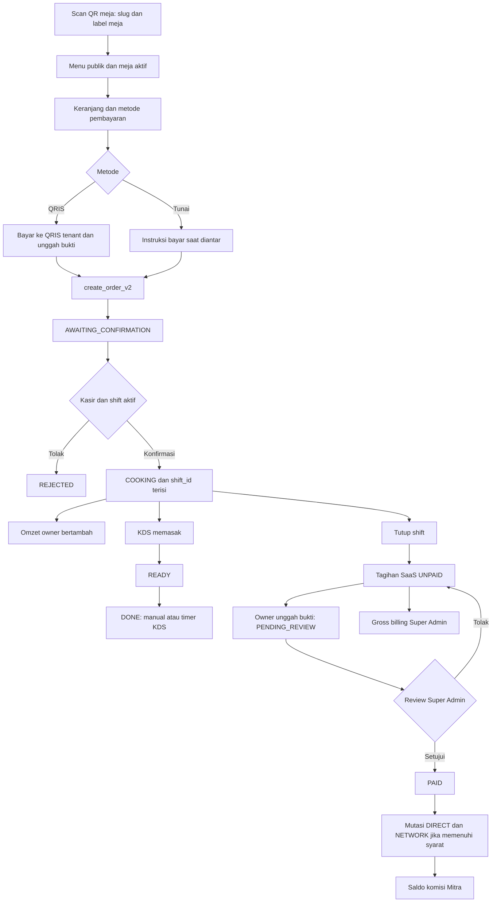

# Laporan audit alur pemesanan dan pendapatan OKESIH

Tanggal: 27 Oktober 2026 (WITA). Baseline kode: `baa7eda`, branch `main`.

## 1. Kesimpulan utama

Alur QR meja → pesanan → konfirmasi kasir → dapur → laporan telah terhubung melalui tabel transaksi dan fungsi database atomik. Namun, angka dan makna status antarlayar belum sepenuhnya konsisten. Laporan pendapatan belum layak dianggap sebagai rekonsiliasi uang diterima dari pelanggan sampai pendapatan bersih platform tanpa koreksi definisi dan implementasi.

Temuan paling penting:

1. Super Admin menghitung struk pending dan komisi estimasi dari tarif tenant, berbeda dengan owner dan ledger komisi Mitra.
2. Satu tenant dengan dua tagihan shift pada tanggal sama dapat muncul dua kali di daftar Super Admin.
3. Pesanan tunai dari QR memperoleh penanda kasir ketika dikonfirmasi. Dapur kemudian melabelinya sebagai tunai di kasir, padahal pelanggan diarahkan membayar saat diantar. Tidak ada pencatatan pelunasan tunai per pesanan pada alur ini.
4. KDS otomatis mengubah `READY` menjadi `DONE` berdasarkan waktu. Status selesai bukan bukti bahwa pesanan sudah diantar atau tunai diterima.
5. Grafik owner tidak ikut menyegarkan data ketika KPI owner berubah. Perbedaan angka dapat terjadi pada layar yang sama.

**Tiga konsep harus dipisahkan:** omzet tenant, tagihan layanan SaaS, dan komisi Mitra. Pesanan Rp20.000 menambah omzet Rp20.000 setelah dikonfirmasi, tetapi hanya menambah satu unit struk untuk biaya SaaS. Komisi Mitra belum bertambah sampai tagihan SaaS dilunasi dan disetujui.

## 2. Metode, cakupan, dan batas kepastian

Audit membaca UI pelanggan, POS, KDS, owner, Mitra, Super Admin, API, autentikasi perangkat, antrean offline, dan urutan migrasi SQL sampai migrasi 37. Definisi SQL terbaru dipakai bila fungsi ditimpa migrasi berikutnya; dokumentasi lama tidak dianggap sebagai sumber kebenaran tunggal.

Validasi yang dilakukan:

- `npm test`: 117 tes lulus, 0 gagal; dua kelompok berisi 72 dan 45 tes.
- `npm run test:database`: seluruh migrasi dan lima berkas assertion berhasil dijalankan di PostgreSQL lokal sementara, database `okesih_remediation_test`.
- [Probe khusus audit](probe-flow.sql): lima skenario masalah direproduksi; pemeriksaan tambahan memastikan tagihan `UNPAID` tidak menghasilkan mutasi komisi. Semua data probe di-rollback.

Label bukti dalam laporan: **SQL lokal** berarti dijalankan pada database sintetis; **kode** berarti dibuktikan melalui pembacaan jalur implementasi, belum melalui interaksi browser; **keputusan bisnis** berarti perilaku sudah jelas tetapi kebijakan yang diinginkan perlu ditetapkan.

Tidak dilakukan transaksi pelanggan, pembayaran bank, unggah bukti, perubahan data produksi, atau simulasi kasir pada tenant nyata. Belum diverifikasi apakah semua migrasi repository sudah terpasang pada database produksi. Tidak ada klaim pengujian kamera QR, notifikasi suara, jaringan perangkat nyata, atau uji browser lintas peran secara menyeluruh. Lulus tes yang tersedia tidak berarti semua temuan audit tertangkap tes lama. Perubahan pekerjaan ini berupa laporan dan probe audit; kode operasional tidak diperbaiki.

## 3. Peta alur aktual



Diagram menunjukkan perilaku implementasi. Panah dari `COOKING` ke tutup shift berarti pesanan tidak harus `DONE` untuk masuk tagihan. Jalur estimasi komisi Super Admin saat ini berbeda dari ledger Mitra dan dibahas pada F01.

### 3.1 QR dan identitas meja

Papan meja menghasilkan URL `/menu/{slug}?t={label}`. Halaman menu juga menerima `tableId`, `tid`, dan `table`. API menu mengembalikan profil usaha aktif, menu tersedia, dan daftar meja aktif. Browser mencocokkan parameter dengan daftar meja; bila tidak cocok, browser mencoba meja tersimpan di `sessionStorage` untuk tenant tersebut.

Saat mengirim, UI menggunakan UUID meja hasil pencocokan, bukan harga atau label yang dipercaya begitu saja. Database memvalidasi bahwa meja aktif milik tenant. QR ini adalah alamat menu dan identitas meja, bukan bukti kehadiran fisik: tautan dapat disalin dan daftar meja tersedia melalui endpoint publik. Ini konsekuensi desain QR statis, bukan bukti akses lintas tenant.

Sumber: [pembuat papan QR](../../../src/lib/table-sign.ts), [menu pelanggan](../../../src/app/menu/[warkopId]/page.tsx), [API menu publik](../../../src/app/api/public/menu/[slug]/route.ts).

### 3.2 Keranjang dan pembayaran pelanggan

Pilihan awal adalah QRIS. QRIS pelanggan memerlukan bukti PNG/JPEG/WebP maksimal 2 MB; tunai tidak memerlukan bukti. Upload QRIS adalah bukti untuk diperiksa manusia, bukan verifikasi settlement bank otomatis. Alur pelanggan tidak memakai OCR billing owner.

API membatasi 1–50 baris item, kuantitas 1–99 per baris, catatan 300 karakter, dan menggunakan rate limit 30 permintaan per 60 detik pada scope pesanan publik. Harga dan ketersediaan dihitung ulang dari database; total frontend tidak dipercaya. Item menyimpan snapshot nama dan harga. Jika harga berubah setelah pelanggan melihat menu/membayar, total server dapat berbeda dari nominal yang sudah dibayar; tidak ada langkah persetujuan harga baru dalam alur ini.

`idempotencyKey` disimpan menurut intent dan payload. Pengiriman ulang dengan key serta hash sama mengembalikan transaksi yang sama; payload berbeda dengan key sama ditolak. Token akses pesanan diturunkan dari tenant dan key, sedangkan database menyimpan hash token. Ini membantu pemulihan respons jaringan yang hilang, tetapi bukan persistensi riwayat pesanan pelanggan setelah refresh.

Sumber: [API pembuatan pesanan](../../../src/app/api/public/orders/route.ts), [intent pesanan](../../../src/lib/order-intent.ts), [RPC pesanan](../../../supabase/migrations/28_atomic_orders.sql).

### 3.3 Masuk kasir

Pesanan QR dibuat sebagai `AWAITING_CONFIRMATION`, belum terkait shift dan belum menambah omzet owner. Nomor antrean diberikan saat pembuatan, bukan saat diterima kasir; penolakan karena itu dapat meninggalkan nomor antrean yang tidak dilayani. Pengalokasian antrean diserialisasi per tenant dan memakai awal hari WITA.

POS mengambil `AWAITING_CONFIRMATION`, `COOKING`, dan `READY`. Konfirmasi/penolakan membutuhkan perangkat POS aktif, akun kasir tenant, dan shift terbuka yang cocok dengan perangkat serta kasir. Konfirmasi menulis `confirmed_at`, `shift_id`, dan `waiter_name = Kasir: ...`.

Bukti QRIS ditampilkan melalui signed URL. Kasir dapat membuka bukti, lalu mengonfirmasi atau menolak. Tidak ada syarat server bahwa bukti sudah dibuka atau cocok dengan mutasi bank. Konfirmasi tunai dari QR tidak memiliki input uang diterima seperti pesanan langsung POS.

Pesanan langsung POS berbeda: hanya online, butuh shift, langsung `COOKING`; untuk tunai, nominal diterima harus minimal total. Perbedaan sumber pesanan ini tidak disimpan sebagai kolom sumber tersendiri di alur yang diperiksa.

Sumber: [POS](../../../src/app/pos/page.tsx), [API transisi](../../../src/app/api/device/orders/route.ts), [bootstrap perangkat](../../../src/app/api/device/bootstrap/route.ts), [RPC pesanan](../../../supabase/migrations/28_atomic_orders.sql).

### 3.4 Dapur, penyelesaian, dan status pelanggan

KDS hanya mengambil `COOKING`/`READY`. Dapur dapat mengubah `COOKING → READY`, lalu `READY → DONE`. POS juga dapat `READY → DONE`. Baris transaksi dikunci selama transisi sehingga dua perangkat tidak bebas menimpa status yang sudah berubah. Pengulangan operasi dengan key yang sama bersifat idempoten; key berbeda pada transisi yang sudah selesai dapat menghasilkan konflik.

KDS menjalankan auto-dismiss berdasarkan `updated_at` dan `queue_dismiss_seconds` (fallback 60 detik) dengan memanggil transisi `DONE`. Ini mengubah status bisnis di server, bukan hanya menyembunyikan kartu. Timer bergantung pada aplikasi KDS yang berjalan.

Pelanggan memeriksa status setiap empat detik dengan bearer token dan berhenti pada `DONE`, `REJECTED`, atau `VOID`. Label QRIS pada halaman status tetap “QRIS sedang diverifikasi” walaupun pesanan telah `COOKING`/`DONE`. `VOID` dikenal di model/filter, tetapi endpoint operasional yang diperiksa tidak menyediakan transisi ke `VOID`, refund, atau pembatalan setelah konfirmasi.

Sumber: [KDS](../../../src/app/kds/page.tsx), [status publik](../../../src/app/api/public/orders/[id]/route.ts), [menu pelanggan](../../../src/app/menu/[warkopId]/page.tsx).

## 4. Definisi angka per peran

| Layar/angka | Sumber dan formula aktual | Waktu/basis pengakuan |
|---|---|---|
| Owner: tunai | Jumlah `total_harga`, metode CASH, status COOKING/READY/DONE | Disaring menurut `created_at`; bukan event uang diterima |
| Owner: QRIS | Jumlah `total_harga`, metode QRIS, status yang sama | Konfirmasi kasir menjadi gerbang operasional |
| Owner: omzet | Tunai + QRIS | Tidak dikurangi biaya SaaS, HPP, komisi, atau pengembalian |
| Owner: struk | Jumlah transaksi pada tiga status sah tersebut | Satu order = satu struk, bukan jumlah item |
| Owner: grafik | Agregat status sah dengan bucket WITA | Hari: 3 jam; minggu/bulan: hari; tahun: bulan |
| Tagihan SaaS | Struk sah pada shift × tarif SaaS saat tutup shift | Tanggal tutup shift; ditambah kode unik untuk jumlah transfer |
| Mitra: total komisi | SUM ledger `marketing_commission_mutations.total_amount` | Terbentuk saat billing PAID; dapat mencakup DIRECT, NETWORK, OPENING |
| Mitra: saldo tersedia | MAX(0, total komisi − `commission_paid` − withdrawal PENDING) | Agregat sepanjang waktu, bukan otomatis periode grafik owner |
| Super Admin: struk overview | Transaksi selain VOID/REJECTED | Termasuk AWAITING_CONFIRMATION; menurut created_at |
| Super Admin: gross billing | SUM `saas_billings.tagihan_pokok` | Menurut tanggal tagihan, semua status pembayaran |
| Super Admin: bagi hasil | SUM tarif tenant saat ini untuk transaksi selain VOID/REJECTED | Estimasi ulang, bukan jumlah ledger DIRECT + NETWORK |
| Super Admin: net revenue | Gross billing − estimasi bagi hasil | Bukan ukuran kas bersih diterima yang sudah direkonsiliasi |

Sumber owner/Mitra: [migrasi 29](../../../supabase/migrations/29_reporting_and_integrity.sql), [API owner](../../../src/app/api/owner/dashboard/route.ts), [API Mitra](../../../src/app/api/marketing/dashboard/route.ts). Sumber overview Super Admin: [migrasi 08](../../../supabase/migrations/08_tenant_regions_and_analytics.sql), yang tidak diganti migrasi setelahnya dalam repository ini.

### 4.1 Jembatan tagihan ke komisi

`end_cashier_shift` menghitung kas yang diharapkan, memanggil `close_shift`, lalu menyimpan kas aktual dan selisih. `close_shift` menghitung status COOKING/READY/DONE dan membuat satu tagihan per shift. Beberapa shift per hari diperbolehkan. Kas aktual yang kurang tidak otomatis mengurangi omzet atau jumlah struk.

Owner mengunggah bukti tagihan sehingga status menjadi `PENDING_REVIEW`. Super Admin menyetujui dengan referensi pembayaran; status berubah menjadi `PAID`. Trigger menghitung komisi langsung bagi Mitra aktif dan bonus hanya untuk upline langsung yang aktif dan berlevel koordinator. Bonus tidak dialirkan ke seluruh rantai upline. Tarif koordinator dapat memakai override.

Tarif, hubungan tenant–Mitra, status Mitra, dan upline dibaca saat pelunasan. Riwayat yang sudah menjadi mutasi menyimpan rate dan nominal; pengulangan settlement tidak boleh menggandakan mutasi. Perubahan tarif sebelum billing lama dibayar dapat mengubah komisi billing lama, bahkan menolak approval apabila komisi baru melebihi pokok tagihan lama. Ini perlu keputusan bisnis mengenai waktu penguncian tarif.

Tagihan pelanggan QRIS dan tagihan SaaS adalah dua pembayaran berbeda: pelanggan membayar tenant, sedangkan owner membayar layanan platform. OCR pada bukti SaaS juga tidak dengan sendirinya melunasi tagihan; approval Super Admin tetap diperlukan.

Sumber: [shift kasir](../../../supabase/migrations/17_cashier_shift_flow.sql), [billing dan integritas](../../../supabase/migrations/31_kormit_payout_integrity.sql), [komisi terbaru](../../../supabase/migrations/33_coordinator_direct_upline_bonus.sql), [API billing owner](../../../src/app/api/owner/billing/route.ts).

### 4.2 Contoh rekonsiliasi

Ilustrasi, bukan tarif produksi: satu order Rp20.000, tarif SaaS Rp100/struk, komisi langsung Rp15, bonus upline Rp5, kode unik Rp123.

| Tahap | Omzet owner | Pokok SaaS | Komisi ledger |
|---|---:|---:|---:|
| Order menunggu kasir | Rp0 | Belum dibuat | Rp0 |
| Kasir konfirmasi | Rp20.000 | Belum dibuat | Rp0 |
| Dapur READY/DONE | Tetap Rp20.000 | Belum dibuat | Rp0 |
| Tutup shift | Tetap Rp20.000 | Rp100; transfer Rp223 | Rp0 |
| Bukti SaaS diunggah | Tetap Rp20.000 | Pending review | Rp0 |
| SaaS disetujui | Tetap Rp20.000 | PAID | Rp15 langsung + Rp5 jaringan |

Margin pokok layanan pada ilustrasi adalah Rp80 sebelum biaya lain. Kode unik perlu kebijakan pencatatan tersendiri. Implementasi overview Super Admin dapat menunjukkan komisi Rp15 sejak pending dan net revenue −Rp15 sebelum ada billing; sesudah billing dapat menunjukkan Rp85, tanpa memasukkan bonus jaringan Rp5. Contoh ini diturunkan dari formula kode, bukan hasil transaksi produksi.

## 5. Temuan rinci dan prioritas

P1 = berpotensi salah keputusan keuangan/operasional; P2 = ketepatan tampilan, pemulihan, atau kebijakan yang perlu diperjelas. Prioritas merupakan penilaian audit, bukan ukuran kerugian produksi yang telah terjadi.

### F01 — P1: definisi Super Admin tidak sama dengan ledger dan owner

**Bukti SQL lokal + kode.** Satu pending menghasilkan tambahan satu struk di overview Super Admin dan nol pada owner. Fungsi overview memakai `NOT IN (VOID,REJECTED)`, sedangkan owner memakai whitelist tiga status sah. Komisi overview dihitung dari `warkops.marketing_commission_per_receipt`, bukan ledger. Gross billing mencakup UNPAID/PENDING_REVIEW; label “gross billing” tepat untuk tagihan, tetapi hasil pengurangannya tidak cukup untuk disebut kas bersih platform.

**Dampak:** pending meningkatkan struk/estimasi komisi; perubahan tarif tenant dapat mengubah estimasi historis; bonus NETWORK tidak masuk; angka Mitra sulit dicocokkan dengan Super Admin.

**Arah perbaikan:** samakan definisi struk sah, pisahkan accrued billing/piutang/paid billing, tampilkan komisi ledger DIRECT dan NETWORK, serta beri definisi periode yang konsisten. Jangan mengganti seluruhnya menjadi PAID tanpa membedakan kebutuhan laporan tagihan dan penerimaan.

### F02 — P1: dua billing sehari menggandakan baris tenant

**Bukti SQL lokal.** Migrasi 31 menghapus keunikan tenant–tanggal demi billing per shift. Namun `report_superadmin_tenants` terbaru pada migrasi 37 masih melakukan JOIN langsung ke billing berdasarkan tenant dan tanggal tanpa agregasi. Probe menghasilkan dua baris data untuk satu tenant, sementara `pagination.total = 1`.

**Dampak:** daftar tenant, nominal billing per baris, status bayar, dan jumlah baris halaman membingungkan. Owner memakai agregasi harian sehingga tampilan dapat berbeda dari Super Admin.

**Arah perbaikan:** agregasikan seluruh billing tenant–tanggal terlebih dahulu; definisikan status gabungan PAID/PENDING_REVIEW/UNPAID; uji dua shift dengan satu lunas dan satu belum lunas. Sumber: [fungsi terbaru](../../../supabase/migrations/37_permanent_entity_deletion.sql).

### F03 — P1: tunai QR ditandai seperti transaksi langsung kasir

**Bukti SQL lokal + kode.** Pelanggan melihat “Bayar tunai saat pesanan diantar”. Konfirmasi QR menulis `waiter_name` berawalan `Kasir:`. KDS menggunakan awalan ini untuk memilih label “TUNAI DI KASIR”, sehingga “TUNAI · TAGIH” tidak dipakai untuk pesanan QR normal yang telah dikonfirmasi.

**Dampak:** staf dapat menganggap uang sudah diterima. Omzet CASH serta kas yang diharapkan sudah naik tanpa event pelunasan per pesanan. Ini membuktikan kesenjangan pencatatan, bukan membuktikan pelanggan nyata belum membayar.

**Arah perbaikan:** simpan `order_source` terpisah dari identitas petugas; pisahkan status pemenuhan dan status pembayaran; catat waktu, penerima, nominal tunai, serta pelunasan. Tentukan apakah CASH harus diterima sebelum dikirim ke dapur atau tetap ditagih saat diantar.

### F04 — P1: DONE otomatis tidak membuktikan penyerahan

**Bukti kode.** KDS memanggil `transitionOrder(..., DONE)` setelah ambang waktu READY. POS melabeli aksi DONE sebagai “Tandai Sudah Diantar”; pelanggan melihat “Pesanan selesai”.

**Dampak:** order dapat hilang dari daftar aktif meskipun belum diambil/diantar; tidak ada penghalang berupa pelunasan tunai. Omzet tidak bertambah dua kali karena COOKING/READY/DONE memakai himpunan status yang sama.

**Arah perbaikan:** pisahkan penyembunyian kartu dari status serah-terima, atau minta aksi petugas untuk penyelesaian. Jika auto-complete dipertahankan, label dan kebijakan pembayaran harus eksplisit.

### F05 — P2: pembaruan grafik owner dan Super Admin tidak mengikuti transaksi

**Bukti kode.** KPI owner berlangganan perubahan database; `RevenueChart` hanya fetch saat mount/periode berubah. Tombol refresh KPI tidak meneruskan revisi ke grafik. Overview Super Admin fetch saat otorisasi, periode, atau `summaryRevision` berubah, tanpa polling transaksi otomatis pada komponen tersebut.

**Dampak:** KPI owner dapat naik sedangkan grafik tetap lama; Super Admin tidak langsung merefleksikan kasir baru saja mengonfirmasi.

**Arah perbaikan:** gunakan invalidasi bersama untuk KPI/grafik dan fallback refresh saat visible/online. Tampilkan waktu sinkronisasi. Sumber: [provider owner](../../../src/components/owner/provider.tsx), [grafik](../../../src/components/owner/RevenueChart.tsx), [dashboard Super Admin](../../../src/components/superadmin/Dashboard.tsx).

### F06 — P2: tanggal order, konfirmasi, billing, dan komisi berbeda

**Bukti SQL lokal + keputusan bisnis.** Order dibuat 23.59 WITA, dikonfirmasi setelah tengah malam: omzet mengikuti `created_at` hari sebelumnya. Probe dengan created_at kemarin dan confirmed_at sekarang menghasilkan omzet hari ini nol. Billing mengikuti tanggal tutup shift, komisi mengikuti settlement.

**Dampak:** laporan harian antarlayar tidak dapat dicocokkan hanya dengan memilih tanggal sama. Ini bukan salah aritmetika; dasar waktu berbeda dan belum dijelaskan kepada pengguna.

**Arah perbaikan:** tetapkan tanggal bisnis untuk setiap metrik dan tampilkan jelas. Jika pendapatan harus mengikuti konfirmasi/pembayaran, ubah basis secara terencana beserta perlakuan data lama. WITA dipakai secara global; belum ada zona waktu berbeda per tenant pada fungsi ini.

### F07 — P2: pelacakan pelanggan hilang setelah refresh

**Bukti kode.** ID order dan token hanya disimpan di React state. Setelah respons sukses, intent lokal dihapus; tidak ada restore order/token. Refresh menghilangkan pelacakan, meskipun order server tetap ada. Tombol “Pesan Sekarang” tidak me-reset `orderStatus`; pesanan kedua dapat sementara memakai status terminal pesanan pertama sampai polling berikutnya.

**Dampak:** pelanggan kehilangan konteks dan berpotensi memesan ulang. Idempotensi hanya melindungi intent yang dipertahankan, bukan dua order baru setelah sukses.

**Arah perbaikan:** persist akses order secara terbatas per tenant/perangkat, sediakan riwayat aktif, dan reset status pada order baru. Uji respons hilang, refresh, dan order kedua.

### F08 — P2: kegagalan identitas meja dapat memakai meja sebelumnya

**Bukti kode.** Jika parameter meja URL tidak ditemukan, halaman mencoba meja terakhir di sessionStorage. QR label yang berubah atau parameter salah dapat berpindah diam-diam ke meja lama. URL print memakai label, sehingga rename label memutus tautan lama bila tidak ada cache yang cocok.

**Dampak:** order sah secara tenant bisa terkirim ke meja yang tidak dimaksud pelanggan.

**Arah perbaikan:** bila URL secara eksplisit memuat meja tidak valid, tampilkan kesalahan dan minta scan ulang; jangan fallback diam-diam. Pertimbangkan identifier QR stabil atau kebijakan cetak ulang setelah rename. Pisahkan keputusan kebutuhan bukti hadir di lokasi dari validasi tenant yang sudah tersedia.

### F09 — P2: shift tanpa struk tetap ditagih kode unik

**Bukti SQL lokal.** `close_shift` selalu membuat billing dan menambahkan kode unik walaupun jumlah struk nol. Probe menghasilkan pokok Rp0 dan total tagihan Rp155 (acak, bukan tarif tetap). Bila rentang kode unik positif, total transfer positif.

**Dampak:** tenant dapat memiliki kewajiban transfer meskipun tidak menjual satu struk; membingungkan untuk layanan per struk.

**Arah perbaikan:** putuskan apakah shift nol dibebaskan/dilewati atau kode unik hanya ditambahkan pada billing positif. Tambahkan assertion untuk shift nol dan shift hanya berisi pesanan ditolak.

### F10 — P2: UI kas shift berpotensi terpotong batas baris

**Bukti kode; belum load-test.** `activeShift` pada API cashier-session mengambil semua `total_harga` CASH tanpa pagination lalu menjumlahkannya di JavaScript. Pada konfigurasi PostgREST dengan batas baris, shift besar dapat menampilkan expectedCash lebih rendah. Error query cashRows juga tidak diperiksa eksplisit. Saat tutup shift, SQL menghitung SUM tanpa batas baris, sehingga hasil penutupan bisa berbeda dari preview.

**Arah perbaikan:** agregasikan preview kas di SQL dan tangani query error; uji lebih dari batas baris yang dikonfigurasi. Sumber: [API sesi kasir](../../../src/app/api/device/cashier-session/route.ts).

### F11 — P2: rata-rata grafik tidak menjelaskan penyebut

**Bukti kode.** `average` adalah rata-rata bucket dengan nilai > 0. Pada periode hari artinya rata-rata bucket tiga jam yang beromzet; pada tahun berarti rata-rata bulan yang beromzet. Ini bukan rata-rata per struk dan bukan rata-rata seluruh hari/bucket termasuk nol. UI hanya menulis “Rata-rata”.

**Arah perbaikan:** labeli penyebut secara tepat atau pilih metrik yang dimaksud bisnis. Sumber: [SQL owner](../../../supabase/migrations/29_reporting_and_integrity.sql), [grafik](../../../src/components/owner/RevenueChart.tsx).

### F12 — P1 kebijakan: riwayat keuangan dapat hilang melalui hapus permanen

**Bukti kode dan assertion proyek.** Migrasi 37 mengizinkan Super Admin menghapus tenant beserta transaksi, billing, dan mutasi komisnya. Hapus Mitra dapat menghapus mutasi miliknya maupun mutasi upline yang bersumber dari Mitra itu. Perlindungan immutable ledger memiliki pengecualian untuk operasi tersebut.

**Dampak:** laporan historis dan saldo dapat turun setelah penghapusan. Saldo tersedia yang memakai MAX(0, ...) dapat menutupi keadaan earned lebih kecil daripada yang sudah dicairkan. Ini perilaku fitur yang sengaja diimplementasikan, bukan otomatis akses tidak sah.

**Arah perbaikan:** tetapkan kebijakan retensi/arsip dan rekonsiliasi historis sebelum angka dipakai sebagai laporan permanen. Jangan mengubah fitur hapus tanpa keputusan pemilik produk. Sumber: [migrasi 37](../../../supabase/migrations/37_permanent_entity_deletion.sql).

## 6. Ketahanan sinkronisasi dan kontrol yang sudah baik

| Permukaan | Mekanisme | Batas praktis |
|---|---|---|
| Pelanggan | Polling 4 detik | Tidak ada order masuk ketika offline; status tergantung token dalam state |
| POS/KDS | Realtime + polling sekitar 3 detik saat ada order, 15 detik ketika kosong | Polling hanya saat visible/online; kegagalan menaikkan jeda sampai 60 detik |
| Perubahan status offline | Disimpan sebelum kirim di antrean lokal, lalu retry | Layar lokal bisa mendahului database; konflik 4xx perlu resolusi |
| Owner KPI | Subscription perubahan tabel | Tidak memiliki fallback interval/foreground pada hook yang diperiksa |
| Owner grafik | Fetch mount/periode | Tidak mengikuti subscription KPI |
| Mitra | Refresh foreground/online dan interval 30 detik | Komisi baru tetap menunggu pelunasan SaaS, bukan sekadar refresh |
| Super Admin overview | Fetch menurut periode/revisi | Tidak ada jaminan setiap order langsung muncul tanpa refresh/invalidation |

Operasi offline dibatasi waktu validasi server terakhir, masa berlaku perangkat, tenant aktif pada snapshot, dan `offline_limit_hours`. Operasi yang gagal tidak otomatis dihapus. Konflik shift telah ditutup bisa memblokir antrean; konfirmasi offline POS belum membuat tiket tersedia di KDS lain sampai tersinkron ke server. Status “berhasil lokal” harus dibedakan dari “sudah diterima dapur”.

Kontrol yang sudah tepat: harga ditentukan server; tenant, menu, dan meja divalidasi; total dan item dibuat atomik; transisi memakai row lock; retry memiliki key/hash; perangkat menggunakan token yang di-hash; status pelanggan dibatasi token pesanan; bukti transfer menggunakan signed URL; laporan owner/Mitra agregasi SQL tidak menjumlahkan halaman UI; billing settlement dan mutasi komisi memiliki penjagaan pengulangan.

Sumber: [hook perangkat](../../../src/lib/use-device-app.ts), [kebijakan offline](../../../src/lib/offline-policy.ts), [konteks Mitra](../../../src/app/marketing/dashboard/MarketingContext.tsx), [otorisasi perangkat](../../../src/lib/device-auth.ts).

## 7. Urutan tindak lanjut dan kriteria penerimaan

1. **Samakan laporan keuangan:** F01/F02. Pending tidak dihitung sebagai struk sah; satu tenant tetap satu baris walaupun banyak shift; komisi aktual dapat ditelusuri ke billing dan mutasi; paid billing dipisahkan dari tagihan terbit.
2. **Pastikan tunai dan penyerahan:** F03/F04. Satu order memiliki sumber, status pembayaran, serta status pemenuhan yang berbeda; staf mengetahui pesanan mana yang masih harus ditagih; timer tidak menyatakan serah-terima tanpa dasar kebijakan.
3. **Perbaiki konsistensi layar/pemulihan:** F05/F07/F08/F10/F11. KPI dan grafik menggunakan snapshot/periode yang konsisten; refresh pelanggan memulihkan order; meja tidak berubah diam-diam; kas shift tidak terpotong limit data.
4. **Tetapkan kebijakan:** F06/F09/F12 serta waktu penguncian tarif komisi. Tentukan tanggal pengakuan, perlakuan shift nol, refund/void setelah konfirmasi, tarif saat order/close/settlement, dan retensi riwayat.

Matriks uji lanjutan:

| Skenario | Hasil yang perlu diverifikasi |
|---|---|
| QRIS QR: kirim, verifikasi kasir, dapur, antar | Satu order, satu struk, bukti terhubung, owner naik satu kali |
| Tunai QR: konfirmasi sebelum uang diterima | Dapur tetap tahu harus menagih; status kas diterima tidak disamakan dengan omzet |
| Tolak sebelum konfirmasi | Tidak menambah omzet, struk billing, atau komisi |
| Dua klik/retry respons hilang | Satu transaksi dan satu transisi; token/status dapat dipulihkan |
| Dua perangkat mengubah order sama | Salah satu sukses, duplikasi tidak merusak status |
| Offline kemudian shift ditutup | Operasi tertunda tidak hilang dan konflik dapat diselesaikan |
| Dua shift satu hari, pembayaran campuran | Satu tenant per baris; total tagihan harian benar |
| Order lintas tengah malam | Tanggal bisnis sesuai definisi yang disepakati |
| Tarif/upline berubah sebelum pelunasan | Komisi mengikuti kebijakan yang disepakati, nominal lama dapat diaudit |
| Billing disetujui dua kali | Tidak ada komisi ganda |
| Lebih dari limit baris pada satu shift | Preview kas sama dengan hasil SQL penutupan |
| Grafik terbuka ketika order dikonfirmasi | KPI dan grafik tersinkron tanpa harus mengganti periode |
| Hapus tenant/Mitra dengan riwayat | Dampak historis sesuai kebijakan dan dapat direkonsiliasi |

## 8. Hasil validasi yang dapat diulang

PostgreSQL lokal sementara menggunakan Unix socket khusus, bukan koneksi produksi. Semua 37 migrasi berhasil diterapkan. Assertion proyek mencakup ACL, idempotensi order, konfirmasi, foreign key tenant, billing manual, replay komisi, rollback atomik, jaringan koordinator, pagination, dan penghapusan permanen.

Probe tambahan menghasilkan:

```text
F01: pending +1 struk Super Admin, 0 struk Owner
F03: order CASH pelanggan memperoleh Kasir marker; cash summary Rp20.000
VERIFIED: order COOKING masuk billing; UNPAID belum menghasilkan komisi
F09: shift nol menghasilkan total tagihan positif dari kode unik
F02: satu tenant dan dua billing menghasilkan dua row; pagination total satu
F06: created_at kemarin, confirmed_at hari ini; omzet owner hari ini nol
ROLLBACK
```

Untuk mengulang, gunakan database disposable bernama tepat `okesih_remediation_test`, jalankan `scripts/test-database.sh`, lalu `psql ... -v ON_ERROR_STOP=1 -f docs/audits/2026-10-27/probe-flow.sql`. Probe memang mengharapkan perilaku bermasalah saat ini; setelah perbaikan, assertion perlu diubah menjadi ekspektasi yang benar. Jangan menjalankan runner migrasi/fixture ke database usaha nyata.

Pemeriksaan produksi berikutnya perlu memastikan versi fungsi aktif dan melakukan UAT pada tenant uji yang disepakati. Hasil lokal ini membuktikan perilaku repository pada data sintetis, bukan jumlah atau nilai transaksi produksi yang terdampak.
